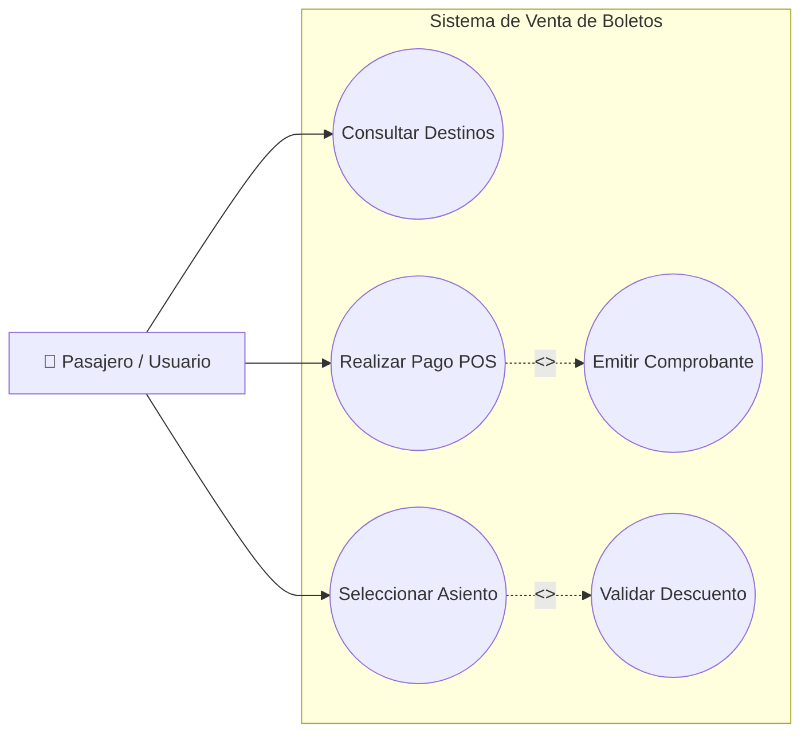
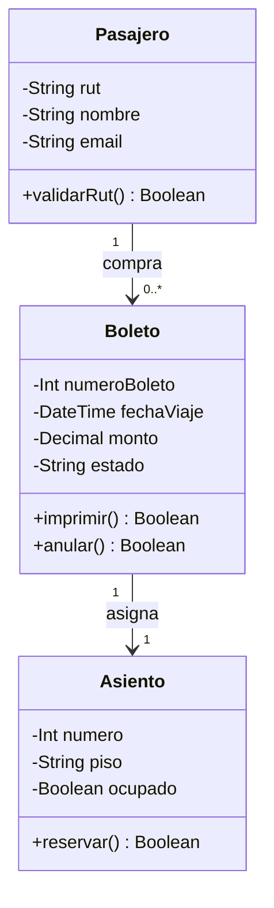
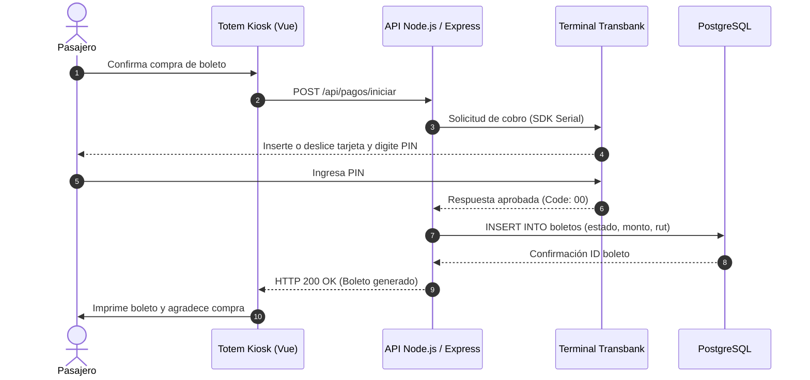

# Analista Programador INACAP - Especialista en Análisis y Modelamiento de Software

Esta skill proporciona las directivas académicas y profesionales exigidas en la carrera de **Analista Programador / Ingeniería en Informática** (especialmente bajo el estándar de INACAP y buenas prácticas de ingeniería de software).

---

## 1. Diagramas de Casos de Uso y Especificación Detallada

### Diagrama en Mermaid:
Representar actores del sistema, límites y casos de uso con relaciones `<<include>>` (obligatorio) y `<<extend>>` (opcional/condicional).

### Tabla de Especificación de Caso de Uso (Formato Estándar INACAP):
Cada caso de uso debe documentarse con la siguiente plantilla:
* **Identificador**: `CU-01`
* **Nombre**: `Realizar Pago con Tarjeta en Kiosco`
* **Actor Principal**: Pasajero
* **Precondición**: El usuario ha seleccionado origen, destino, horario y asiento válido.
* **Flujo Normal (Happy Path)**:
  1. El sistema solicita al usuario acercar o insertar la tarjeta en el terminal POS.
  2. El sistema envía la solicitud de cobro al backend local.
  3. El usuario autoriza la transacción ingresando su clave PIN.
  4. El terminal POS responde con código de autorización exitoso (`00`).
  5. El sistema envía la señal de impresión de boleto a la impresora térmica.
  6. El sistema finaliza la sesión y retorna a la pantalla de bienvenida.
* **Flujos Alternativos / Excepciones**:
  - `3a. Cancelación por usuario`: El usuario presiona la tecla roja en el POS -> El sistema notifica la cancelación y permite reintentar el pago.
  - `4a. Fondos insuficientes / Rechazo bancario`: El POS retorna código de error -> El sistema muestra pantalla amigable y solicita otro medio de pago.
  - `5a. Falla de impresora / Sin papel`: El sistema registra la transacción aprobada y emite alerta en pantalla con código de recuperación.
* **Postcondición**: Boleto emitido, asiento marcado como ocupado en la base de datos y lote contable actualizado.

---

## 2. Diagramas de Clases UML
Modelar clases con atributos tipados, visibilidad (`+` público, `-` privado, `#` protegido) y multiplicidades exactas (`1`, `0..1`, `1..*`, `*`):

---

## 3. Diagramas de Secuencia UML
Representar interacciones temporales entre actores, controladores, servicios y bases de datos:

---

## 4. Modelamiento de Base de Datos y Normalización
1. **Modelo Conceptual / DER**: Entidades fuertes, débiles, atributos clave y cardinalidades.
2. **Normalización Paso a Paso**:
   * **1FN (Primera Forma Normal)**: Eliminar grupos repetitivos; todos los atributos son atómicos y existe clave primaria.
   * **2FN (Segunda Forma Normal)**: Cumplir 1FN y que todos los atributos no clave dependan funcionalmente de la totalidad de la clave primaria (eliminar dependencias parciales).
   * **3FN (Tercera Forma Normal)**: Cumplir 2FN y que ningún atributo no clave dependa transitivamente de la clave primaria (eliminar dependencias transitivas).
